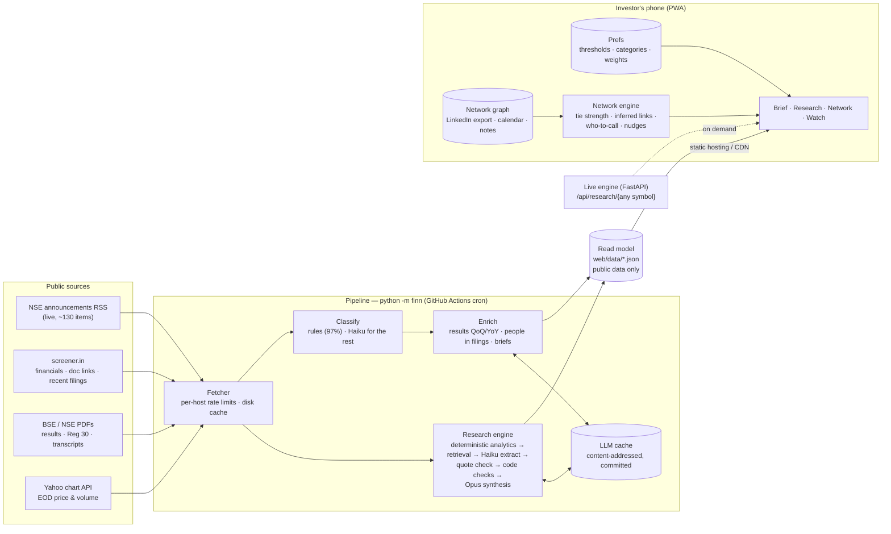

# FINN — architecture

FINN has one rule that shapes everything else: **public data is processed centrally; the investor's
private data (their network, positions, and judgement) stays on their device.** The two meet only in
the browser, joined on organisation ids.

## 1. Data pipelines

| Source | How it's fetched | Refresh | Stored as | Why this source |
|---|---|---|---|---|
| **Corporate announcements** | NSE's public RSS (`Online_announcements.xml`), appended to our own log (`data/rss_log.json`) because the feed holds only ~130 items. Backfilled from screener.in's per-company "recent" list (BSE links). | every 30 min on trading days | `events.json` | The RSS is NSE's published machine-readable feed. We deliberately do **not** scrape NSE's cookie-protected JSON API. |
| **EOD prices & volume** | Yahoo Finance chart endpoint (`.NS`), plus `^NSEI` for index-relative moves | every 30 min (EOD after close) | `eod.json` (1 year) | One request per symbol, no pandas dependency. |
| **Fundamentals** | screener.in company page (consolidated, falling back to standalone) + its cash-flow schedule endpoint for capex | 6-hour cache | inside each dossier | Standardised 10-year P&L, balance sheet, cash flow and ratios — transcribed from filings. We use the numbers, never screener's pros/cons or AI summaries. |
| **Concall transcripts** | PDF links from screener.in; when a company IR site refuses the download, the exchange-filed copy | immutable, cached forever | page-indexed text | Primary source for guidance. |
| **Results filings** | the PDF attached to the results announcement | immutable | page-indexed text | Used when the standardised tables haven't caught up (e.g. Kaynes, filed the evening before this build). |
| **People in filings** | the Reg 30 filing itself — SEBI requires a "brief profile" for every KMP/director appointment — plus earlier notices it refers to | per event | `events.json` → `people[]` | Primary, public, and needs no LinkedIn scraping. |
| **Investor network** | the investor's own LinkedIn data export (`Connections.csv`), calendar, notes | on the device | `network.json` (demo: synthetic) | The investor's own data, with their consent. |

**Politeness & robots.** Every request goes through one fetcher with per-host spacing (screener 1.6 s,
BSE 1 s), retries with back-off, a plain identifying user agent and an on-disk cache. robots.txt
disallows `/company/source/quarter/*` on screener, so results PDFs are taken from the announcements.

**Linking things to each other (entity resolution).**
- *Company ↔ filing*: NSE RSS gives the company name → normalised (`norm_org`) → NSE equity master → symbol.
- *Same filing on two exchanges*: BSE and NSE copies arrive within hours with different URLs; we merge by
  symbol + category + time window + title overlap, keeping the other copy as a related link.
- *Person in a filing ↔ person in your network*: never by name. Each employer/school in an appointee's
  extracted career is resolved to an **organisation id** (NSE symbol for listed companies, a slug from
  `data/orgs.json` otherwise, with aliases such as "Kellogs" → `kelloggs`). The network stores the same
  ids. The device then infers links from *overlapping years at the same organisation*, weighted by
  organisation size, function match and seniority — and says so in words, with a confidence.
- *Notice ↔ approval*: an appointment's outcome filing rarely repeats the profile; the pipeline looks
  back 60 days for the notice, and the device merges person records by name, keeping the richest.

**Scoring.** The pipeline assigns an *intrinsic* score (how much could this move the stock): category
and subtype base, order size relative to trailing revenue, rating direction, immaterial-amount guard,
division-level vs company-level roles (from the extracted people), and the index-relative price
reaction on the next session. The device adds *personal* relevance: position size, the investor's
chosen categories, and whether they know people there. Every rank shows its reasons.

## 2. Security & privacy

- **The network never leaves the device.** It is loaded into the browser and every network computation
  (tie strength, inferred links, who-to-call, nudges, expertise map) runs in `web/js/network.js`. The
  server and the model only ever see public data: filings, transcripts, prices. In the demo the network
  is a synthetic JSON file shipped with the app; in production it is built on the device from the
  investor's LinkedIn export and calendar and stored encrypted (WebCrypto, key in the platform keychain),
  optionally synced end-to-end-encrypted between the investor's own devices.
- **No model sees personal data.** LLM calls are made on public documents only. The `expertise_needed`
  field in event briefs exists precisely so the *device* can match topics to contacts without sending
  contacts anywhere.
- **What we store about people in filings.** Name, role, career and education *as disclosed in the
  filing*, with a link to that filing — already public, and kept only as long as the event is in the
  45-day window. People who are not in filings and not in the investor's network are never stored.
- **Consent.** Contacts are imported by the investor from their own exports. Nothing is scraped from
  LinkedIn. Each contact shows its source ("Your LinkedIn export", "Your calendar", "Added by you") and
  can be deleted; deleting removes it from every inference immediately because nothing is precomputed.
- **Insider-information guardrail.** When the best person to call currently works at a listed company,
  FINN says so and reminds the investor to keep the conversation to public information (SEBI PIT
  Regulations). Former employees rank above current ones for "context" calls.
- **Access control in a real deployment.** Per-investor tenancy (OIDC sign-in), the read model
  partitioned per portfolio, row-level security on any server-side store, secrets only in the
  platform's secret store (never in the repo — `render.yaml` marks the key `sync: false`), audit log of
  every export, and retention: event data 45 days, LLM cache keyed by public-document hashes only.

## 3. LLMs and agents

| Step | Model | Why this model | Guardrails |
|---|---|---|---|
| Classify announcements | **rules** (97% of filings); Claude Haiku 5.5 only for vague titles | Exchange subjects are a controlled vocabulary — rules are exact, auditable and free | regression tests on real misfires |
| Results headline numbers | **deterministic** from reported tables; Haiku reads the results PDF only when tables lag | Numbers should come from tables, not a model | all-null extraction → "pending", never a table of dashes |
| People in a management change | Haiku 5.5 | Reading a short filing for a profile is extraction, not reasoning | only people named in *this* filing are kept; org names resolved by code |
| One-line briefs for material events | Haiku 5.5 | Short, bounded summarisation | length limits; "say so plainly if routine" |
| Guidance from transcripts | Haiku 5.5 on **retrieved** passages | High volume (4 calls × N companies); retrieval cuts ~80% of tokens first | every quote machine-verified against the transcript; unverifiable quotes dropped |
| Promise checks | **code** | Numeric promises vs reported numbers is arithmetic | segment-level targets are not checked against consolidated numbers |
| Credibility, narrative vs numbers, bull/bear | **Claude Opus 5.5** (high effort) | The one step that needs judgement across many facts | must cite evidence ids (G*, F:*, C*); no outside knowledge; "too early" over invention |

**Cost discipline.** Every call is keyed by `sha256(task, prompt version, model, inputs)` and cached in
`data/llm_cache/` (committed). Filings are immutable, so a daily refresh calls a model only for
documents it has never seen. Per company, a full dossier is ~4 Haiku calls on ~4–5k tokens each (a tenth of
a cent in total) plus one Opus call (~4–5k tokens in, ~5k out — about 13 US cents), and it is reused until a
new quarter or a new call arrives. Measured for this build (estimated from token counts at API list prices):
118 model outputs ≈ $2.69 — 98 Haiku extractions $0.08, 20 Opus judgements $2.61 (97% of the bill). The next levers, in order: the Batch API for the evening build
(−50%), then Claude Sonnet 5.5 for synthesis if an eval shows it holds quality (−50% again).

**Agents.** There is no autonomous agent in the serving path, by design: the workflow is a fixed
pipeline where code decides what to fetch and which model step runs, and the model never takes an
action. That keeps cost bounded and every output traceable. The one place an agent earns its keep is
*Ask* over a company's documents ("what did they say about working capital in the last two calls?") —
a tool-using loop over the same retrieval + quote-verification tools; it is the first thing on the
roadmap.

**How the demo's model outputs were produced.** The build environment had no usable Anthropic API key.
The pipeline therefore wrote each model step as a self-contained job (rendered prompt + JSON schema) to
`.cache/llm_jobs/`; those jobs were run offline on Claude Haiku 5.5 (extraction) and Claude Opus 5.5
(synthesis) with the same prompts, schema-validated by `python -m finn llm-check`, and imported with
`python -m finn llm-import`. Every cached record carries
this provenance. With `ANTHROPIC_API_KEY` set, the identical prompts go through the API instead.

## 4. Cloud — what runs where

| Piece | Where | Why |
|---|---|---|
| Pipeline (push every 30 min, full build every evening) | GitHub Actions cron | Free, versioned, logs per run; the snapshot is committed so history is auditable. A failed refresh redeploys the last good snapshot, and a refresh never throws away enrichment (people, briefs, promise ledgers) it couldn't recompute — it carries the last good version forward and labels its age. |
| The app + read model | GitHub Pages (static CDN) | Nothing to keep alive; loads instantly on a phone; the PWA caches the shell for offline use. |
| Live engine for any NSE symbol | FastAPI container (`Dockerfile`, `render.yaml` one-click on Render's free tier) | Research on a ticker nobody pre-computed needs a server; deterministic sections return in seconds. |
| Secrets | GitHub Actions secrets / Render env vars | Never in the repo. |
| Production next step | Postgres (events, dossiers) + object storage (PDF text) + a queue for model jobs; web-push for alerts | The JSON read model is the right shape for a prototype; a multi-user product needs per-tenant storage and push delivery. |
